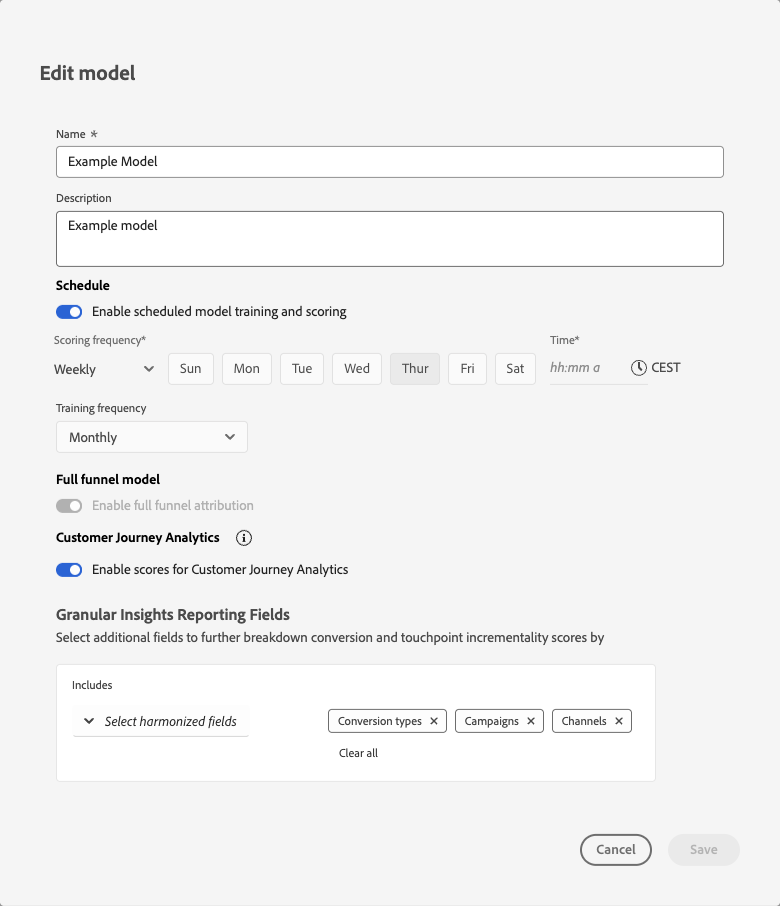

# Modèles - Aperçu

{{mm-mca-rebranding}}

La fonctionnalité de modèle de Marketing Campaign Analytics vous permet de configurer, d’entraîner et de noter des modèles spécifiques à vos objectifs commerciaux. La formation et la notation prennent en charge l’apprentissage du transfert piloté par l’IA entre l’attribution multipoint et la modélisation du mix marketing.

Les modèles sont basés sur les données harmonisées que vous créez dans le cadre du workflow d’application.

Un modèle dans Marketing Campaign Analytics est un modèle de machine learning utilisé pour mesurer et prédire un résultat spécifié en fonction des investissements d’un spécialiste marketing. Les points de contact marketing et les données au niveau du résumé peuvent être utilisés comme entrées. Marketing Campaign Analytics vous permet de créer des variantes de modèles en fonction de différents ensembles de variables, dimensions et résultats, tels que les revenus, les unités vendues et les prospects.

Un modèle nécessite :

* Une conversion.
* Un ou plusieurs points de contact marketing (canaux) composés de données de niveau résumé, de données de point de contact marketing (données d’événement) ou les deux.
* Intervalle de recherche en amont configurable.
* Un créneau de formation configurable.

Un modèle peut éventuellement inclure :

* Facteurs externes.
* Facteurs internes.
* Connaissance préalable des contributions marketing provenant d’autres sources telles que l’expérience passée des parties prenantes, les tests incrémentiels, d’autres modèles.
* Le partage des dépenses, qui utilise le partage des dépenses relatives comme proxy lorsque les données marketing sont clairsemées.

Lorsqu’un modèle est créé pour la première fois, la création lance immédiatement le processus de formation et de notation. Une fois la formation initiale et l’exécution de notation terminées, les informations de modèle sont disponibles pour révision. Un modèle peut ensuite être recyclé. En outre, des données peuvent être ajoutées au modèle, ce qui nécessite que vous lui attribuiez un nouveau score manuellement. Le recyclage et la notation sont un processus itératif au fur et à mesure que de nouveaux résultats et de nouvelles informations apparaissent et que des ajustements sont nécessaires pour obtenir un modèle qui correspond le mieux à vos objectifs commerciaux.

## Modélisation full funnel

{{release-limited-testing-section}}

La modélisation complète de funnel permet de modéliser les étapes réelles de leur funnel. Par exemple, de l’inscription à la newsletter à un achat. La modélisation complète de funnel montre comment le marketing déplace les clients dans ce funnel. La modélisation funnel complète attribue du crédit aux canaux funnel supérieurs pour les conversions que ces canaux influencent en aval et réconcilie les résultats afin que les contributions s’additionnent correctement sans double comptage.

Vous utilisez la modélisation funnel complète pour effectuer le modèle sur un KPI funnel supérieur et un KPI funnel inférieur.

* Les abonnements aux newsletters et d’autres mesures de sensibilisation à la marque sont des exemples d’indicateurs clés de funnel supérieurs.
* Les mesures de conversion standard, telles que les recettes et les commandes, sont des exemples de mesures funnel inférieures.

Les tactiques de funnel supérieures sont souvent moins créditées dans un modèle MMM axé sur la conversion. La modélisation funnel complète permet de comprendre les éléments suivants :

* Quels médias et tactiques marketing ont contribué à l’objectif de la version supérieure de funnel ?
* Quelles sont les tactiques marketing et les médias qui ont eu un impact indirect sur l’objectif de conversion ? Les poids supérieurs du modèle funnel sont une entrée du modèle inférieur funnel afin de donner un poids supérieur aux médias et aux tactiques marketing, le cas échéant.

## Créer des modèles

Pour créer un modèle, utilisez le flux de configuration du modèle guidé pas à pas de Marketing Campaign Analytics disponible lorsque vous sélectionnez **[!UICONTROL Open model canvas]**. Voir [Créer des modèles](build.md) pour plus d’informations.

## Gestion des modèles

Pour afficher un tableau de vos modèles actuels, dans l’interface de Marketing Campaign Analytics :

1. Sélectionnez  **[!UICONTROL Models]** dans le rail de gauche.

1. Un tableau des modèles actuels s’affiche.

   Les colonnes du tableau indiquent des détails sur le modèle.

   | Nom de la colonne | Détails |
   |---|---|
   | **[!UICONTROL Name]** | Nom du modèle. Si un modèle est activé pour la modélisation funnel complète, une page [!BADGE Full funnel]{type=Informative} s’affiche. |
   | **[!UICONTROL Description]** | Description du modèle. |
   | **[!UICONTROL Conversion event]** | Conversion sélectionnée pour le modèle. |
   | **[!UICONTROL Run frequency]** | Fréquence d’exécution de l’entraînement du modèle. |
   | **[!UICONTROL Last run]** | Date et heure du dernier entraînement du modèle. |
   | **[!UICONTROL Status]** | Statut du modèle. |

   Pour trier le tableau sur n’importe quelle colonne dans l’ordre croissant  ou décroissant , sélectionnez le titre de la colonne.

   Pour trier ou redimensionner la colonne **[!UICONTROL Name]**, sélectionnez **[!UICONTROL Name]** . Dans le menu contextuel, sélectionnez **[!UICONTROL Sort ascending]**, **[!UICONTROL Sort descending]** ou **[!UICONTROL Resize column]**. Vous pouvez également pointer sur le séparateur de colonnes pour redimensionner la colonne **[!UICONTROL Name]**.

   L’état signalé du modèle dépend de l’emplacement d’un modèle dans son cycle de vie. Par exemple, si un modèle est créé, (ré)entraîné avec succès ou non, ou (ré)noté avec succès ou non.

   Dans le tableau ci-dessous :

   *  - Indique la réussite de l’exécution d’une étape dans le cycle de vie du modèle.
   *  - Indique l’exécution en cours d’une étape du cycle de vie du modèle.
   *  - indique l’échec de l’exécution d’une étape dans le cycle de vie du modèle.

   | État | [Créer](/help/models/build.md) | [Train](/help/models/train-score.md#train) | [Score](/help/models/train-score.md#score) | [Recycler](/help/models/train-score.md#train) | [Score](/help/models/train-score.md#score) |
   |---|:---:|:---:|:---:|:---:|:---:|
   | En cours |  | | | | |
   | En cours |  |  | | | |
   | En cours |  |  |  | | |
   | En cours |  |  |  |  | |
   | En cours |  |  |  |  |  |
   | Echec de l&#39;apprentissage |  |  | | | |
   | Echec de l&#39;apprentissage |  |  |  |  | |
   | Formation réussie |  |  | | | |
   | Formation réussie |  |  |  |  | |
   | Échec de la notation |  |  |  | | |
   | Échec de la notation |  |  |  |  |  |
   | Notation réussie |  |  |  | | |
   | Notation réussie |  |  |  |  |  |

   {style="table-layout:fixed"}

1. Pour modifier les colonnes affichées pour la liste, sélectionnez  et activez/désactivez les colonnes sur .

Vous pouvez effectuer les actions suivantes sur un modèle spécifique.

### Informations sur le modèle

La fonctionnalité d’informations sur les modèles n’est disponible que sur les modèles entraînés et notés avec succès.

Pour afficher les informations d’un modèle :

1. Sélectionnez  **[!UICONTROL Models]** dans le rail de gauche.
1. Sélectionnez le nom du modèle.

Vous êtes redirigé vers [&#x200B; Model Insights &#x200B;](insights.md).

### Afficher les détails

Pour afficher plus de détails sur un modèle :

1. Sélectionnez  **[!UICONTROL Models]** dans le rail de gauche.

1. Sélectionnez  pour qu’un modèle affiche un pop-up avec des détails tels que **[!UICONTROL Description]**, **[!UICONTROL Run frequency]**, **[!UICONTROL Last run status]**, **[!UICONTROL Spend share]**, etc.

### Dupliquer

Vous pouvez rapidement dupliquer un modèle.

1. Sélectionnez  **[!UICONTROL Models]** dans le rail de gauche.

1. Sélectionnez  pour un modèle, puis sélectionnez **[!UICONTROL Duplicate]** dans le menu contextuel.

Vous êtes redirigé vers les étapes de création d’un modèle, avec un nom proposé composé du nom du modèle d’origine suivi de **[!UICONTROL (Copy)] (_n_)**.

### Modifier

Vous pouvez modifier le nom, la description, la planification de l’entraînement et la notation d’un modèle.

1. Sélectionnez  **[!UICONTROL Models]** dans le rail de gauche.

1. Sélectionnez  pour un modèle, puis sélectionnez **[!UICONTROL Edit]** dans le menu contextuel.

   Dans la boîte de dialogue **[!UICONTROL Edit model]** :

   

   * Saisissez un nouveau **[!UICONTROL Name]** et une nouvelle **[!UICONTROL Description]**.

   * Pour activer la planification, activez **[!UICONTROL Enable schedule model training and scoring]**. Vous pouvez uniquement activer la planification pour les modèles entraînés et notés.

     1. Sélectionner un **[!UICONTROL Scoring frequency]** :

        * **[!UICONTROL Daily]** : saisissez une heure valide (par exemple, `10:00 am`) ou utilisez  pour définir l’heure.
        * **[!UICONTROL Weekly]** : sélectionnez un jour de la semaine et saisissez une heure valide (par exemple, `10:00 am`) ou utilisez  pour définir l’heure.
        * **[!UICONTROL Monthly]** : sélectionnez un jour du mois dans le menu déroulant Exécuter sur chaque et saisissez une heure valide (par exemple `10:00 am`) ou utilisez  pour définir l’heure.

     1. Sélectionnez un **[!UICONTROL Training frequency]** dans le menu déroulant : **[!UICONTROL Monthly]**, **[!UICONTROL Quarterly]**, **[!UICONTROL Yearly]** ou **[!UICONTROL None]**.

   * Pour mettre à jour les [champs de rapport d’informations granulaires](/help/models/build.md#granular-insights-reporting-fields), dans la section **[!UICONTROL Granular Insights Reporting Fields]** :
     1. Sélectionnez un ou plusieurs champs harmonisés à partir des **[!UICONTROL _Sélectionner les champs harmonisés_]** sous **[!UICONTROL Includes]**. Les champs harmonisés sélectionnés sont ajoutés au panneau.
     1. Sélectionnez **[!UICONTROL *Champ harmonisé&#x200B;*]** pour supprimer un champ harmonisé du conteneur avec les champs harmonisés sélectionnés.
     1. Sélectionnez **[!UICONTROL Clear all]** pour supprimer tous les champs harmonisés sélectionnés.

     >[!IMPORTANT]
     >Tout modèle avec MTA créé avant le 12 janvier 2026 doit être dupliqué pour activer les informations de modèle granulaires. 
     >Une notation est requise pour tout modèle existant afin de refléter les dimensions granulaires mises à jour dans les données de notation.
     >

1. Sélectionner **[!UICONTROL Save]**.

### Entraîner

Recyclez un modèle lorsque vous souhaitez inclure de nouvelles données de facteur et de marketing incrémentiel. Pour plus d’informations, voir [Modèles de formation et de notation](train-score.md#train).

### Score

Vous pouvez attribuer un score incrémentiel à un modèle en fonction de nouvelles données marketing ou attribuer un score à un modèle pour une période spécifique. Pour plus d’informations, voir [Modèles de formation et de notation](train-score.md#score).

### Suppression de modèles

Pour supprimer un modèle :

1. Sélectionnez  **[!UICONTROL Models]** dans le rail de gauche.
1. Sélectionnez  pour un modèle, puis sélectionnez **[!UICONTROL Delete]** dans le menu contextuel. Vous pouvez également sélectionner  **[!UICONTROL Delete]** dans la barre d’actions bleue.
1. Sélectionnez **[!UICONTROL Delete]** dans la boîte de dialogue de confirmation de **[!UICONTROL Delete model]** pour supprimer le modèle. Sélectionnez **[!UICONTROL Cancel]** pour annuler.

Pour supprimer plusieurs modèles :

1. Sélectionnez plusieurs modèles.
1. Dans la barre d’actions bleue, sélectionnez  **[!UICONTROL Delete]** pour supprimer les modèles.
1. Sélectionnez **[!UICONTROL Delete]** dans la boîte de dialogue de confirmation **[!UICONTROL Delete *x *models]**&#x200B;pour supprimer les modèles. Sélectionnez **[!UICONTROL Cancel]**&#x200B;pour annuler.

